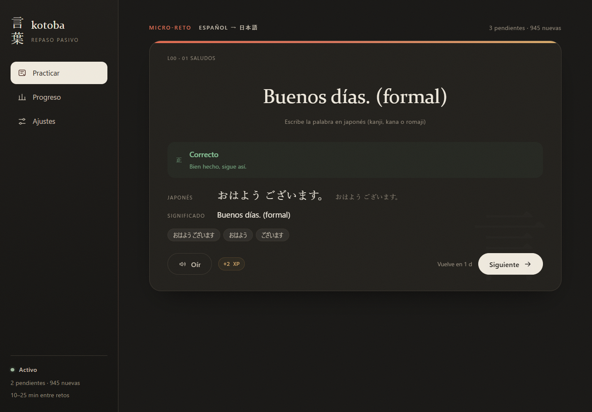
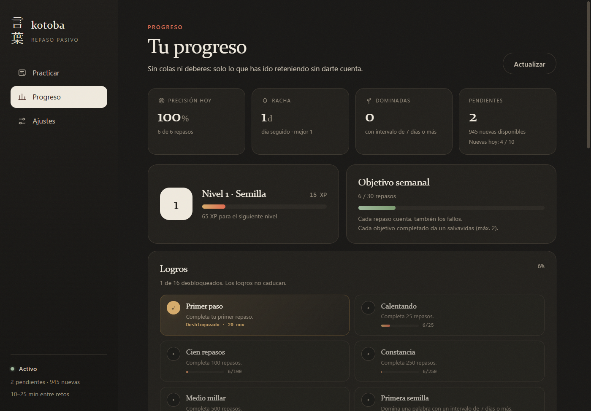
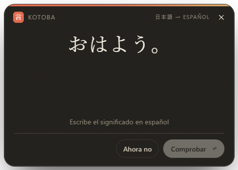
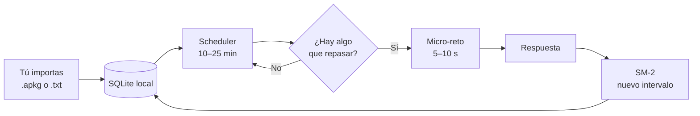

<div align="center">

# 言葉 · kotoba

**Aprende vocabulario japonés sin sentarte a estudiar.**

Una app de escritorio para Windows que vive en la bandeja del sistema y, cada cierto tiempo, te
propone un micro-reto de 5–10 segundos. Sin abrir nada, sin cuentas y sin nube.


[](https://github.com/JavierOrtunoRoig/kotoba/actions/workflows/ci.yml)
[](https://github.com/JavierOrtunoRoig/kotoba/releases)

[Qué es](#qué-es-kotoba) · [Capturas](#capturas) · [Características](#características) ·
[Instalación](#instalación) · [Desarrollo](#desarrollo) · [Privacidad](#privacidad) ·
[Roadmap](#roadmap)

</div>



## Qué es kotoba

*kotoba* (言葉, «palabra») parte de una idea sencilla: **el vocabulario se aprende en los huecos del
día**, no en sesiones de una hora. En vez de pedirte que abras una app, kotoba te trae el repaso a
ti: un popup discreto, un widget en una esquina o una notificación nativa. Respondes, recibes
feedback y sigues con lo que estabas haciendo.

Detrás hay **repetición espaciada SM-2 invisible**. Cada respuesta ajusta cuándo volverá a aparecer
la palabra, así que el repaso se concentra justo donde estás a punto de olvidar.

El contenido sale de **tu propio export de Anki**, normalmente el mazo *Genki 1*. kotoba no incluye
ni redistribuye el mazo: tú importas el tuyo y la app mantiene su propio progreso, sin tocar el de
Anki.

## Capturas

| Progreso | Micro-reto |
|:---:|:---:|
|  |  |

## Características

### Aprendizaje

- **Bidireccional**: japonés → español y español → japonés, con dirección aleatoria o alternada.
- **Respuestas flexibles**: acepta kanji, kana y romaji, varias acepciones, paréntesis opcionales y
  variantes de romanización (`ha`/`wa`, vocales largas, `tsu` pequeño).
- **SM-2 completo**: calidad de respuesta, factor de facilidad, pasos de aprendizaje (10 minutos y
  1 día) y tope de intervalo de 10 años.
- **Audio** del mazo: automático en japonés → español y después de responder en español → japonés.
- **Progreso con sentido**: XP solo por respuestas correctas según su calidad, 12 niveles con
  títulos, racha flexible con hasta 2 salvavidas, objetivo semanal, 16 logros y maestría por lección.
- **Nuevas en orden**: las palabras nuevas siguen el orden del mazo (lección → subapartado), con
  límite diario configurable y prioridad para los repasos vencidos.

### Importación

- **`.apkg` moderno**: lee `collection.anki21b` (SQLite schema 18), descomprime zstd, interpreta el
  mapa protobuf de medios y verifica los audios con SHA-1.
- **`.txt` de Anki**: soporta `#separator`, `#tags column` y `#columns`, además del formato clásico
  de 8 columnas.
- **Mapeo manual de campos**: antes de importar, la app inspecciona el mazo y muestra una vista
  previa. Puedes asignar lectura, kanji, significado, glosa, audio, UID, etiquetas, lección y
  subapartado, tanto por columnas en `.txt` como por tipo de nota en `.apkg`.
- **Deduplicación** por lectura y significado normalizados, con unión de notas repetidas entre
  capítulos.
- **Patrones y plantillas** (`〜`, `+`, `...`) detectados y excluidos del repaso por defecto.
- **Progreso en vivo** durante la importación, con avisos de notas omitidas.

### Discreción

- **Bandeja del sistema** con menú de practicar, pausar, abrir y salir; arranque con Windows
  opcional.
- **Tres modos de aparición**: popup, widget persistente o toast nativo de Windows.
- **No molestar**: horario configurable, máximo diario, detección de apps a pantalla completa y
  restauración del foco de la ventana anterior al mostrar el popup.
- **Notificaciones de hitos** opcionales (objetivo semanal y logros), respetando DND y pantalla
  completa.

### Tus datos

- **Todo local**: SQLite en `%APPDATA%\com.kotoba.app`, sin red, sin cuentas y sin telemetría.
- **Copia de seguridad y restauración** de la base y el audio.
- **Exportación del historial** de repasos a CSV.
- **Logs a archivo** con acceso desde Ajustes.

### Accesibilidad y apariencia

- Tema **claro, oscuro o automático** (sigue el tema de Windows en vivo).
- Interfaz en **español, inglés o japonés**, incluidos bandeja y notificaciones.
- **Escala de fuente** de 90 % a 125 %, con ventanas flotantes escaladas en proporción.
- Navegación por teclado, foco visible, `aria-current`/`aria-pressed`, enlace «saltar al contenido»
  y respeto por `prefers-reduced-motion`.

## Cómo funciona



1. Importas el mazo una vez y revisas el mapeo de campos.
2. El scheduler espera un intervalo aleatorio (10–25 minutos por defecto).
3. Antes de mostrar nada comprueba pausa, horario de no molestar, máximo diario y pantalla completa.
4. Aparece un micro-reto; puedes responder, pedir la lectura o descartarlo con «Ahora no».
5. La respuesta actualiza el SM-2 y, si procede, el XP, la racha y los logros.

## Instalación

### Descarga

Los instaladores de la última versión están en
[**Releases**](https://github.com/JavierOrtunoRoig/kotoba/releases):

- `kotoba_0.1.0_x64_en-US.msi` — instalador clásico de Windows.
- `kotoba_0.1.0_x64-setup.exe` — instalador NSIS, útil sin permisos de administrador.

> Los binarios todavía no están firmados digitalmente, así que Windows SmartScreen puede pedir
> confirmación la primera vez. También puedes compilarlo tú mismo con las instrucciones de abajo.

### Requisitos

- Windows 10 u 11 con **WebView2** (viene preinstalado en Windows 11 y en la mayoría de Windows 10).
- Para compilar: Node.js 20+, Rust estable y los Build Tools de Visual Studio con MSVC.

### Desde el código

```powershell
git clone https://github.com/JavierOrtunoRoig/kotoba.git
cd kotoba
npm install
npm run tauri dev
```

Para generar los instaladores:

```powershell
npm run tauri build
```

Salen en `src-tauri/target/release/bundle/`:

- `msi/kotoba_0.1.0_x64_en-US.msi`
- `nsis/kotoba_0.1.0_x64-setup.exe`

## Primer uso

1. En Anki: **Archivo → Exportar → Paquete de mazo de Anki (`.apkg`)** del mazo que quieras usar.
2. Abre kotoba: si la biblioteca está vacía, te guiará la pantalla de importación.
3. Revisa el **mapeo de campos** que propone la app y ajústalo si tu mazo usa otros nombres.
4. Importa y comprueba el resumen (palabras, audios, duplicados y patrones).
5. Ajusta intervalo, modo, horario de no molestar y límite diario en **Ajustes**.
6. Deja kotoba en la bandeja. El siguiente reto llegará solo.

Los datos viven en `%APPDATA%\com.kotoba.app` (base SQLite + `media/`) y los logs en
`%LOCALAPPDATA%\com.kotoba.app\logs\kotoba.log`.

## Desarrollo

Comandos habituales, desde la raíz del repositorio:

| Comando | Qué hace |
|---|---|
| `npm run tauri dev` | Levanta Vite y la app Tauri con recarga en caliente |
| `npm run tauri build` | Build de producción e instaladores |
| `npm run typecheck` | Comprueba TypeScript |
| `npm run build` | TypeScript + build de Vite |
| `cd src-tauri; cargo check` | Comprueba Rust sin enlazar |
| `cd src-tauri; cargo test --lib` | Tests unitarios del backend |

Algunos tests de integración dependen del mazo real y están marcados como `ignored`:

```powershell
cd src-tauri
cargo test --lib imports_real_genki_deck -- --ignored --nocapture
cargo test --lib normalizes_real_deck_answers -- --ignored --nocapture
```

El segundo valida **2.629 respuestas** generadas desde el mazo real: kanji, lecturas, romaji,
significados y basura que debe rechazarse.

### Estructura

```
src/                     Frontend React
  MainApp.tsx            Navegación, tema y estado global
  PracticePanel.tsx      Micro-reto y feedback
  StatsPanel.tsx         Progreso, nivel, racha y logros
  SettingsPanel.tsx      Ajustes, datos e importación
  ImportPanel.tsx        Primer arranque e importación
  MappingDialog.tsx      Asistente de mapeo de campos
  i18n.ts                Textos en español, inglés y japonés
  styles.css             Paleta clara/oscura y layout

src-tauri/src/           Backend Rust
  db.rs                  Esquema SQLite, migraciones, SM-2, XP y estadísticas
  import.rs              Importador .apkg / .txt y mapeo de campos
  media.rs               Mapa de medios de Anki (protobuf + zstd)
  text.rs                Limpieza de HTML, normalización y validación
  scheduler.rs           Planificador pasivo
  shell.rs               Ventanas, foco y notificaciones
  tray.rs                Icono y menú de la bandeja
  i18n.rs                Traducciones de bandeja y notificaciones
```

La base de conocimiento del proyecto vive en [`.opencode/`](.opencode/README.md): decisiones de
arquitectura, requisitos, comandos y estado.

### CI y releases

- **CI** ([`ci.yml`](.github/workflows/ci.yml)): en cada push a `main` y en cada pull request se
  ejecutan `npm run typecheck`, `npm run build`, `cargo check` y `cargo test --lib` sobre Windows.
- **Release** ([`release.yml`](.github/workflows/release.yml)): al empujar una etiqueta `v*` (o al
  lanzarlo a mano desde Actions) se compila la app y se publica una release con el MSI y el NSIS.
  El workflow comprueba antes que la etiqueta coincida con la versión de `tauri.conf.json`.

Para publicar una versión:

1. Sube la versión en `package.json`, `src-tauri/Cargo.toml` y `src-tauri/tauri.conf.json`.
2. Crea y empuja la etiqueta:

   ```powershell
   git tag v0.1.0
   git push origin v0.1.0
   ```

3. GitHub Actions compila y publica la release con los instaladores adjuntos.

## Privacidad

- **Sin red**: la app no hace peticiones HTTP. No hay cuentas, sincronización ni telemetría.
- **Sin contenido de terceros**: no se descarga ni se incluye el mazo; solo se importa tu archivo.
- **Todo borrable**: desde Ajustes puedes reiniciar el progreso, borrar la biblioteca o restaurar una
  copia. También puedes eliminar `%APPDATA%\com.kotoba.app` a mano.

## Roadmap

- [x] MVP técnico: bandeja, scheduler, importación `.txt`/`.apkg`, ejercicio bidireccional y SQLite.
- [x] Pulido: tres modos, DND, pantalla completa, SM-2, estadísticas, copias de seguridad y logs.
- [x] Gamificación: XP por calidad, niveles, racha con salvavidas, objetivo semanal y 16 logros.
- [x] Apariencia y accesibilidad: temas, tres idiomas y escala de fuente.
- [x] Nuevas en orden de mazo, repasos primero y límite diario.
- [x] Mapeo manual de campos al importar.
- [x] Pipeline de CI y releases automáticas con MSI y NSIS.
- [ ] Sincronización opcional con AnkiConnect.
- [ ] Más mazos (Genki 2) y contenido de gramática/partículas.
- [ ] Firma de código del instalador.
- [ ] Verificación real de pantalla completa en juegos y presentaciones.

## Contribuir

Las issues y los pull requests son bienvenidos. Antes de enviar cambios:

1. Ejecuta `npm run typecheck` y `cargo test --lib`.
2. Mantén el estilo del código que ya existe (Rust con `rustfmt`, React con TypeScript estricto).
3. Usa [Conventional Commits](https://www.conventionalcommits.org/): `feat:`, `fix:`, `docs:`,
   `refactor:`, `test:`, `chore:`.

Si encuentras un fallo, incluye los pasos para reproducirlo, la versión de Windows y, si puedes, el
final de `%LOCALAPPDATA%\com.kotoba.app\logs\kotoba.log`.

## Licencia

El código de kotoba se publica bajo la licencia **MIT**. Consulta [`LICENSE`](LICENSE).

El contenido de los mazos **no** forma parte del repositorio ni se redistribuye. *Genki* es una obra
de The Japan Times; usa tu propia copia y tu propio export de Anki. *Anki* es un proyecto
independiente y kotoba solo lee sus archivos de exportación.

## Agradecimientos

- [Anki](https://apps.ankiweb.net/) por el formato de exportación y por hacer posible el repaso
  espaciado.
- [Genki](https://genki.japantimes.co.jp/) por el vocabulario que inspira el proyecto.
- [Tauri](https://tauri.app/), [React](https://react.dev/), [Vite](https://vite.dev/) y
  [rusqlite](https://github.com/rusqlite/rusqlite), que sostienen la app.

---

<details>
<summary><strong>English summary</strong></summary>

**kotoba** is a passive Japanese vocabulary trainer for Windows. It sits in the system tray and
occasionally shows a 5–10 second flashcard while you work. Answers are scheduled with an invisible
SM-2 algorithm, so reviews land right before you forget.

- Bidirectional JP ↔ ES practice with kanji, kana and romaji input.
- Imports Anki `.apkg` (schema 18, zstd, protobuf media map) and `.txt`, with a manual field-mapping
  wizard.
- Three display modes (popup, widget, native toast), do-not-disturb hours, fullscreen detection and
  no focus stealing.
- Local SQLite only: no accounts, no cloud, no telemetry.
- XP, levels, flexible streaks, weekly goal and 16 achievements.

Built with Tauri 2, React 19, TypeScript and Rust. Licensed under MIT; deck content is not
redistributed.

</details>
