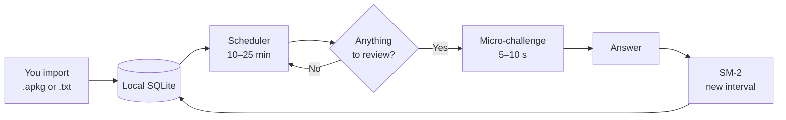

<div align="center">

# 言葉 · kotoba

**Learn Japanese vocabulary without sitting down to study.**

A desktop app for Windows that lives in the system tray and, every so often, offers you a
5–10 second micro-challenge. No opening anything, no accounts, no cloud.


[](https://github.com/JavierOrtunoRoig/kotoba/actions/workflows/ci.yml)
[](https://github.com/JavierOrtunoRoig/kotoba/releases)

[What it is](#what-is-kotoba) · [Screenshots](#screenshots) · [Features](#features) ·
[Installation](#installation) · [Development](#development) · [Privacy](#privacy) ·
[Roadmap](#roadmap)

</div>


## What is kotoba

*kotoba* (言葉, "word") starts from a simple idea: **vocabulary is learned in the gaps of the
day**, not in hour-long sessions. Instead of asking you to open an app, kotoba brings the review
to you: a discreet popup, a widget in a corner, or a native notification. You answer, get
feedback, and carry on with what you were doing.

Behind the scenes there is **invisible SM-2 spaced repetition**. Each answer adjusts when the word
will come back, so review concentrates exactly where you are about to forget.

The content comes from **your own Anki export**, usually the *Genki 1* deck. kotoba does not include
or redistribute the deck: you import yours and the app keeps its own progress, without touching
Anki's.

## Screenshots

| Progress | Micro-challenge |
|:---:|:---:|
|  |  |

## Features

### Learning

- **Bidirectional**: Japanese → Spanish and Spanish → Japanese, with random or alternating direction.
- **Flexible answers**: accepts kanji, kana and romaji, several senses, optional parentheses and
  romanization variants (`ha`/`wa`, long vowels, small `tsu`).
- **Full SM-2**: answer quality, ease factor, learning steps (10 minutes and
  1 day) and a 10-year interval cap.
- **Audio** from the deck: automatic on Japanese → Spanish and after answering on Spanish → Japanese.
- **Meaningful progress**: XP only for correct answers according to their quality, 12 levels with
  titles, a flexible streak with up to 2 saves, a weekly goal, 16 achievements and mastery per lesson.
- **New words in order**: new words follow deck order (lesson → subsection), with a
  configurable daily limit and priority for overdue reviews.

### Import

- **Modern `.apkg`**: reads `collection.anki21b` (SQLite schema 18), decompresses zstd, interprets
  the protobuf media map and verifies audio files with SHA-1.
- **Anki `.txt`**: supports `#separator`, `#tags column` and `#columns`, plus the classic
  8-column format.
- **Manual field mapping**: before importing, the app inspects the deck and shows a preview.
  You can assign reading, kanji, meaning, gloss, audio, UID, tags, lesson and
  subsection, both per column in `.txt` and per note type in `.apkg`.
- **Deduplication** by normalized reading and meaning, merging repeated notes across
  chapters.
- **Patterns and templates** (`〜`, `+`, `...`) detected and excluded from review by default.
- **Live progress** during import, with warnings about skipped notes.

### Discretion

- **System tray** with a menu to practise, pause, open and quit; optional
  start with Windows.
- **Three display modes**: popup, persistent widget or native Windows toast.
- **Do not disturb**: configurable hours, daily maximum, fullscreen app detection and
  restoration of the previous window's focus when the popup is shown.
- **Optional milestone notifications** (weekly goal and achievements), respecting DND and
  fullscreen.

### Your data

- **All local**: SQLite in `%APPDATA%\com.kotoba.app`, no network, no accounts and no telemetry.
- **Backup and restore** of the database and audio.
- **Review history export** to CSV.
- **File logs** with access from Settings.

### Accessibility and appearance

- **Light, dark or automatic** theme (follows the Windows theme live).
- Interface in **Spanish, English or Japanese**, including tray and notifications.
- **Font scale** from 90% to 125%, with floating windows scaled proportionally.
- Keyboard navigation, visible focus, `aria-current`/`aria-pressed`, a "skip to content" link
  and respect for `prefers-reduced-motion`.

## How it works



1. You import the deck once and review the field mapping.
2. The scheduler waits a random interval (10–25 minutes by default).
3. Before showing anything it checks pause, do-not-disturb hours, daily maximum and fullscreen.
4. A micro-challenge appears; you can answer, ask for the reading or dismiss it with "Not now".
5. The answer updates SM-2 and, where applicable, XP, the streak and achievements.

## Installation

### Download

Installers for the latest version are on
[**Releases**](https://github.com/JavierOrtunoRoig/kotoba/releases):

- `kotoba_0.3.0_x64-setup.exe` — NSIS installer, no administrator permissions. **Recommended**:
  the automatic updater uses this format.
- `kotoba_0.3.0_x64_en-US.msi` — classic Windows installer (requires administrator).

> The binaries are not digitally signed yet, so Windows SmartScreen may ask for
> confirmation the first time. You can also build it yourself with the instructions below.

From the version with the updater onwards, kotoba checks GitHub Releases on startup and offers to
install the new version (also manually in Settings → System). That first installation is still
manual; after that, updates are downloaded and applied from within the app.

### Requirements

- Windows 10 or 11 with **WebView2** (preinstalled on Windows 11 and on most Windows 10).
- To build: Node.js 20+, stable Rust and the Visual Studio Build Tools with MSVC.

### From source

```powershell
git clone https://github.com/JavierOrtunoRoig/kotoba.git
cd kotoba
npm install
npm run tauri dev
```

To generate the installers:

```powershell
npm run tauri build
```

They end up in `src-tauri/target/release/bundle/`:

- `msi/kotoba_0.3.0_x64_en-US.msi`
- `nsis/kotoba_0.3.0_x64-setup.exe`

## First use

1. In Anki: **File → Export → Anki Deck Package (`.apkg`)** for the deck you want to use.
2. Open kotoba: if the library is empty, the import screen will guide you.
3. Review the **field mapping** the app proposes and adjust it if your deck uses other names.
4. Import and check the summary (words, audio, duplicates and patterns).
5. Adjust interval, mode, do-not-disturb hours and daily limit in **Settings**.
6. Leave kotoba in the tray. The next challenge will arrive on its own.

Data lives in `%APPDATA%\com.kotoba.app` (SQLite database + `media/`) and logs in
`%LOCALAPPDATA%\com.kotoba.app\logs\kotoba.log`.

### Anki deck compatibility

Use a modern Anki export with **Support older Anki versions** turned off and **Include Media**
enabled if you want audio. The importer covers Basic (Front/Back), Basic with a reversed card,
text Cloze with a separate meaning field, packages containing several decks, and note types
with a dedicated audio field. Map custom fields to reading and meaning in the import dialog.

kotoba imports one item per note, reveals cloze text and drops its hints. It reads the mapped
fields directly. Anki templates, scheduling, image occlusion, and cloze markup mixed with
MathJax are outside this import format. Notes with no reading or meaning are skipped with a warning.
The importer uses the first embedded `[sound:…]` reference in the mapped audio field.

Each note takes its lesson and category from its own deck unless the mapping supplies those
values. For example, `Japanese::Lesson 2::Places::Outdoors` gives lesson `Lesson 2` and category
`Places / Outdoors`. If cards from one note are in different decks, the card with the lowest ID
provides the deck. Reimporting the same package with the same mapping reuses its source IDs.

## Development

Common commands, from the repository root:

| Command | What it does |
|---|---|
| `npm run tauri dev` | Starts Vite and the Tauri app with hot reload |
| `npm run tauri build` | Production build and installers |
| `npm run typecheck` | Checks TypeScript |
| `npm run build` | TypeScript + Vite build |
| `cd src-tauri; cargo check` | Checks Rust without linking |
| `cd src-tauri; cargo test --lib` | Backend unit tests |
| `npm run test:e2e:windows` | Windows desktop import, practice and persistence E2E |

The desktop E2E command builds a dedicated test binary and uses WebdriverIO's
embedded Tauri driver. It requires the normal Windows Tauri build prerequisites.
It starts two separate app processes with an isolated temporary profile and
removes the profile afterwards. The test window stays hidden while the real
WebView2 and Tauri backend run. The harness supplies the synthetic deck path at
the native file picker boundary; the native picker itself is not exercised.
Import inspection, import, practice, IPC and SQLite persistence are real. The
same command runs in Windows CI.

Some integration tests depend on the real deck and are marked `ignored`:

```powershell
cd src-tauri
cargo test --lib imports_real_genki_deck -- --ignored --nocapture
cargo test --lib normalizes_real_deck_answers -- --ignored --nocapture
```

The second one validates **2,629 answers** generated from the real deck: kanji, readings, romaji,
meanings and garbage that must be rejected.

### Structure

```
src/                     React frontend
  MainApp.tsx            Navigation, theme and global state
  PracticePanel.tsx      Micro-challenge and feedback
  StatsPanel.tsx         Progress, level, streak and achievements
  SettingsPanel.tsx      Settings, data and import
  ImportPanel.tsx        First run and import
  MappingDialog.tsx      Field mapping wizard
  i18n.ts                Texts in Spanish, English and Japanese
  styles.css             Light/dark palette and layout

src-tauri/src/           Rust backend
  db.rs                  SQLite schema, migrations, SM-2, XP and stats
  import.rs              .apkg / .txt importer and field mapping
  media.rs               Anki media map (protobuf + zstd)
  text.rs                HTML cleanup, normalization and validation
  scheduler.rs           Passive scheduler
  shell.rs               Windows, focus and notifications
  tray.rs                Tray icon and menu
  i18n.rs                Tray and notification translations
```

The project's knowledge base lives in [`.opencode/`](.opencode/README.md): architecture
decisions, requirements, commands and status.

### CI and releases

- **CI** ([`ci.yml`](.github/workflows/ci.yml)): on every push to `main` and on every pull request
  it runs `npm run typecheck`, `npm run build`, `cargo check` and `cargo test --lib` on Windows.
- **Release** ([`release.yml`](.github/workflows/release.yml)): pushing a `v*` tag (or triggering it
  manually from Actions) builds the app and publishes a release with the MSI and the NSIS.
  The workflow first checks that the tag matches the version in `tauri.conf.json`.

To publish a version:

1. Bump the version in `package.json`, `src-tauri/Cargo.toml` and `src-tauri/tauri.conf.json`.
2. Create and push the tag:

   ```powershell
   git tag v0.3.0
   git push origin v0.3.0
   ```

3. GitHub Actions builds and publishes the release with the installers attached.

## Privacy

- **No network**: the app makes no HTTP requests. There are no accounts, sync or telemetry.
- **No third-party content**: the deck is neither downloaded nor included; only your file is imported.
- **Everything erasable**: from Settings you can reset progress, delete the library or restore a
  backup. You can also delete `%APPDATA%\com.kotoba.app` by hand.

## Roadmap

- [x] Technical MVP: tray, scheduler, `.txt`/`.apkg` import, bidirectional exercise and SQLite.
- [x] Polish: three modes, DND, fullscreen, SM-2, stats, backups and logs.
- [x] Gamification: XP by quality, levels, streak with saves, weekly goal and 16 achievements.
- [x] Appearance and accessibility: themes, three languages and font scale.
- [x] New words in deck order, reviews first and daily limit.
- [x] Manual field mapping on import.
- [x] CI pipeline and automatic releases with MSI and NSIS.
- [ ] Optional AnkiConnect sync.
- [ ] More decks (Genki 2) and grammar/particle content.
- [ ] Installer code signing.
- [ ] Real fullscreen detection in games and presentations.

## Contributing

Issues and pull requests are welcome. Before submitting changes:

1. Run `npm run typecheck` and `cargo test --lib`.
2. Keep the existing code style (Rust with `rustfmt`, React with strict TypeScript).
3. Use [Conventional Commits](https://www.conventionalcommits.org/): `feat:`, `fix:`, `docs:`,
   `refactor:`, `test:`, `chore:`.

If you find a bug, include the steps to reproduce it, your Windows version and, if you can, the
tail of `%LOCALAPPDATA%\com.kotoba.app\logs\kotoba.log`.

## License

kotoba's code is published under the **MIT** license. See [`LICENSE`](LICENSE).

Deck content is **not** part of the repository and is not redistributed. *Genki* is a work
by The Japan Times; use your own copy and your own Anki export. *Anki* is an independent
project and kotoba only reads its export files.

## Acknowledgements

- [Anki](https://apps.ankiweb.net/) for the export format and for making spaced repetition
  possible.
- [Genki](https://genki.japantimes.co.jp/) for the vocabulary that inspires the project.
- [Tauri](https://tauri.app/), [React](https://react.dev/), [Vite](https://vite.dev/) and
  [rusqlite](https://github.com/rusqlite/rusqlite), which power the app.

---

<details>
<summary><strong>English summary</strong></summary>

**kotoba** is a passive Japanese vocabulary trainer for Windows. It sits in the system tray and
occasionally shows a 5–10 second flashcard while you work. Answers are scheduled with an invisible
SM-2 algorithm, so reviews land right before you forget.

- Bidirectional JP ↔ ES practice with kanji, kana and romaji input.
- Imports Anki `.apkg` (schema 18, zstd, protobuf media map) and `.txt`, with a manual field-mapping
  wizard.
- Three display modes (popup, widget, native toast), do-not-disturb hours, fullscreen detection and
  no focus stealing.
- Local SQLite only: no accounts, no cloud, no telemetry.
- XP, levels, flexible streaks, weekly goal and 16 achievements.

Built with Tauri 2, React 19, TypeScript and Rust. Licensed under MIT; deck content is not
redistributed.

</details>
